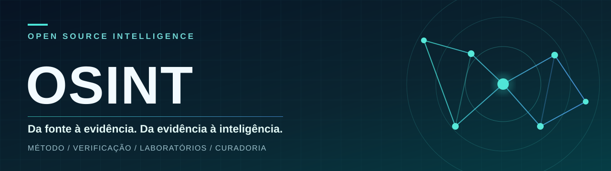
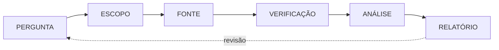

<p align="center">
  
</p>

<p align="center">
  <strong>Um hub aberto para aprender OSINT, avaliar evidências e produzir inteligência rastreável.</strong><br>
  Métodos · Fontes · Trilhas guiadas · Laboratórios · Modelos profissionais
</p>

<p align="center">
  <a href="docs/trilha-inicial.md"></a>
  <a href="labs/README.md"></a>
  <a href="docs/indice.md"></a>
</p>

<p align="center">
  <a href="CONTRIBUTING.md">Contribuir</a> ·
  <a href="recursos/README.md">Catálogo de fontes</a> ·
  <a href="docs/qualidade-e-etica.md">Qualidade e ética</a> ·
  <a href="ROADMAP.md">Roadmap</a> ·
  <a href="docs/acervo.md">Acervo legado</a>
</p>

---

## OSINT com método. Não apenas links.

**OSINT** (*Open Source Intelligence*) exige perguntas claras, fontes legais e pertinentes, verificação, julgamento analítico e uma entrega que outra pessoa consiga revisar. **Encontrar dados não equivale a produzir inteligência.**

Neste repositório, toda prática deve responder quatro questões:

> **O que sabemos?** · **Como sabemos?** · **O que não sabemos?** · **O que mudaria nossa conclusão?**



## Comece pelo seu objetivo

| Quero… | Caminho recomendado | Resultado |
|---|---|---|
| **Aprender do zero** | [Trilha inicial](docs/trilha-inicial.md) | Primeira análise reproduzível |
| **Ter um método profissional** | [Método operacional](docs/metodo.md) | Pergunta, escopo, evidências e encerramento |
| **Avaliar notícias ou fontes** | [Avaliação VISTA](docs/avaliacao-de-fontes.md) | Origem, independência e limitações |
| **Evitar vieses e conclusões frágeis** | [Análise estruturada](docs/analise-estruturada.md) | Hipóteses alternativas e contraevidências |
| **Trabalhar com CTI e SOC** | [OSINT para CTI](docs/osint-cti.md) | Nota defensiva com evidências |
| **Validar imagens, mapas e datas** | [GEOINT / IMINT](docs/geoint-imint.md) | Avaliação visual responsável |
| **Padronizar evidências e relatórios** | [Dados e proveniência](docs/dados-e-proveniencia.md) | Registro auditável |
| **Estudar com exercícios** | [6 laboratórios](labs/README.md) | Casos fictícios com gabarito |

## Biblioteca técnica

| Bloco | Materiais | Para quem |
|---|---|---|
| **01 · Fundamentos** | [Método](docs/metodo.md) · [Ética](docs/qualidade-e-etica.md) · [Verificação](docs/verificacao.md) | Todos os níveis |
| **02 · Tradecraft analítico** | [Avaliação de fontes](docs/avaliacao-de-fontes.md) · [Hipóteses](docs/analise-estruturada.md) | Analistas e pesquisadores |
| **03 · Domínios OSINT** | [CTI](docs/osint-cti.md) · [GEOINT/IMINT](docs/geoint-imint.md) · [Casos de uso](docs/casos-de-uso.md) | Aplicações especializadas |
| **04 · Engenharia de evidências** | [Proveniência](docs/dados-e-proveniencia.md) · [Templates](templates/README.md) | Quem prepara relatórios |
| **05 · Bibliografia e fontes** | [Leituras essenciais](recursos/leituras-essenciais.md) · [Ferramentas](recursos/ferramentas.md) · [Catálogo CSV](recursos/catalogo.csv) | Estudo e curadoria |
| **06 · Laboratórios** | [Índice e rubricas](labs/README.md) | Treino reproduzível |

A [trilha por competências](docs/indice.md) organiza a sequência sugerida e diferencia o que está entregue do que ainda está planejado.

## Laboratórios práticos

| # | Tema | Habilidade |
|---|---|---|
| [01](labs/01-evidencias/README.md) | Coincidência não é vínculo | Observação ≠ inferência |
| [02](labs/02-triangulacao/README.md) | Três fontes, uma origem | Dependência de fontes |
| [03](labs/03-verificacao-temporal/README.md) | O horário que não fecha | Fusos e cronologia |
| [04](labs/04-qualidade-de-fontes/README.md) | Duas notícias e uma premissa | Avaliação de alegações |
| [05](labs/05-osint-cti/README.md) | Boletim não é atribuição | CTI defensiva |
| [06](labs/06-validacao-visual/README.md) | A imagem mostra, a legenda afirma | Verificação visual |

**Todos são sintéticos**, sem alvos reais e sem necessidade de instalar ferramentas. Cada exercício inclui objetivos, registros, missão e resolução comentada.

## Ferramentas não substituem raciocínio

Uma fonte primária pode estar errada; um agregador pode omitir contexto; três notícias podem ser cópias do mesmo comunicado. Por isso, nosso [catálogo](recursos/README.md) informa finalidade e limites de cada referência.

O [`catalogo.csv`](recursos/catalogo.csv) é um índice simples para pesquisa e manutenção. **Data de revisão editorial não significa teste funcional ou auditoria de segurança de serviços externos.**

### Leituras de referência

- [Berkeley Protocol — HRC/OHCHR](https://humanrights.berkeley.edu/publications/berkeley-protocol-on-digital-open-source-investigations/): investigação digital e preservação responsável.
- [ODNI / ICD 203](https://www.intel.gov/mission/our-values/objectivity): rigor, fontes e incertezas em produtos de inteligência.
- [Bellingcat Toolkit](https://bellingcat.gitbook.io/toolkit): ferramentas por finalidade.
- [Exposing the Invisible](https://kit.exposingtheinvisible.org/en/): técnicas didáticas de investigação.
- [NIST SP 800-61 Rev. 3](https://csrc.nist.gov/pubs/sp/800/61/r3/final): resposta a incidentes integrada ao risco.
- [Berkeley — Evaluating Digital Open Source Imagery](https://humanrights.berkeley.edu/publications/evaluating-digital-open-source-imagery-a-guide-for-judges-and-fact-finders/): avaliação de imagens digitais.

## Organização do repositório

```text
OSINT/
├── docs/                Método, trilhas, guias analíticos e ética
├── labs/                Seis estudos fictícios e critérios de avaliação
├── templates/           Plano, registro, hipóteses e relatório
├── recursos/            Bibliografia, ferramentas e catálogo CSV
├── tools/               Validador local e testes de qualidade
├── assets/              Identidade visual do projeto
├── Scripts/             Legado (sem auditoria nesta versão)
├── TOOLS/ IMINT/ SOCMiNT/  Acervo histórico em revisão
└── arquivo/             Material anterior preservado
```

## Contribuição e governança

Comece pelo [guia de contribuição](CONTRIBUTING.md). Sugestões devem trazer fonte identificável, finalidade, limitações, revisão editorial e exemplos fictícios ou autorizados. As verificações automáticas cobrem documentação local, links internos e estrutura do catálogo.

**Limites:** o acervo legado não constitui recomendação operacional. Não publicar dados pessoais, credenciais, bases de vazamento ou conteúdo que cause exposição indevida. [Política de qualidade e ética](docs/qualidade-e-etica.md).

**Autoria e curadoria:** [Ridd1kulusC0d3r](https://github.com/Ridd1kulusC0d3r). Projetos relacionados: [Mineiro OSINT Extractor](https://github.com/Ridd1kulusC0d3r/Mineiro-OSINT-Extractor) · [Tropeiro Intel](https://github.com/Ridd1kulusC0d3r/tropeiro-intel) · [T4lks](https://github.com/Ridd1kulusC0d3r/T4lks).

> **Licenciamento:** ainda não foi definida licença para reutilização do material. Até uma escolha explícita do mantenedor, não presuma autorização para redistribuir o conteúdo fora das permissões padrão da plataforma.

<p align="center"><sub>OSINT | Da fonte à evidência. Da evidência à inteligência. · Revisão editorial: 09/11/2026</sub></p>
