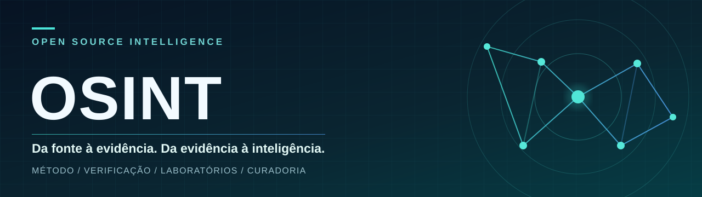
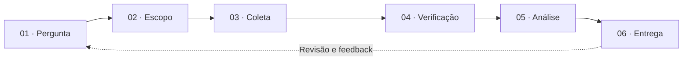

<p align="center">
  
</p>

<p align="center">
  <strong>Aprenda a investigar melhor, verificar afirmações e comunicar resultados reproduzíveis.</strong><br>
  Um hub aberto de métodos, fontes, laboratórios e modelos para OSINT responsável.
</p>

<p align="center">
  <a href="docs/indice.md"></a>
  <a href="labs/01-evidencias/README.md"></a>
  <a href="recursos/README.md"></a>
</p>

<p align="center">
  <a href="CONTRIBUTING.md">Contribuições</a> ·
  <a href="docs/qualidade-e-etica.md">Ética e qualidade</a> ·
  <a href="ROADMAP.md">Roadmap</a> ·
  <a href="docs/acervo.md">Acervo histórico</a>
</p>

> **A proposta:** OSINT não é uma coleção de links nem a capacidade de encontrar qualquer dado. É um processo orientado por perguntas, fontes legítimas, verificação e limites explícitos de confiança.

## 🧭 Escolha seu caminho

| Se você quer… | Comece por | Entrega concreta |
| :--- | :--- | :--- |
| Aprender do zero | [Trilha de entrada](docs/trilha-inicial.md) | Primeira análise documentada |
| Estruturar uma investigação | [Método operacional](docs/metodo.md) | Plano, hipóteses e critérios de encerramento |
| Verificar uma alegação | [Guia de verificação](docs/verificacao.md) | Quadro de evidências e limitações |
| Explorar um tema | [Mapa das trilhas](docs/indice.md) | Percurso por competência |
| Conhecer fontes e ferramentas | [Catálogo editorial](recursos/README.md) | Seleção explicada, não lista infinita |
| Produzir uma entrega profissional | [Templates](templates/README.md) | Relatório rastreável e revisável |
| Treinar sem expor ninguém | [Laboratórios](#-laboratórios-reproduzíveis) | Casos sintéticos com gabarito |

## 🔎 Da pergunta à resposta



**O que diferencia uma boa investigação:** a pergunta pode ser respondida; a origem da informação é rastreável; observações não são confundidas com hipóteses; fontes aparentemente diferentes são avaliadas quanto à independência; e a conclusão mostra o que ainda não sabemos.

## 🧩 Áreas de conhecimento

| Disciplina | Questões tratadas | Material |
| :--- | :--- | :--- |
| **Fundamentos e ciclo de inteligência** | O que buscar? Quando encerrar? | [Método](docs/metodo.md) |
| **Pesquisa e arquivos web** | Como comparar páginas e versões? | [Fontes](recursos/fontes-e-referencias.md) |
| **Verificação digital** | Conteúdo, origem, tempo e contexto conferem? | [Verificação](docs/verificacao.md) |
| **GEOINT e IMINT** | Que pistas visuais são verificáveis? | [Trilhas](docs/indice.md) |
| **SOCMINT** | O que é observável sem violar a privacidade? | [Trilhas](docs/indice.md) |
| **OSINT para CTI e defesa** | Como priorizar sinais públicos relevantes? | [Casos de uso](docs/casos-de-uso.md) |
| **Dados públicos brasileiros** | Quais instituições são a origem dos dados? | [Fontes](recursos/fontes-e-referencias.md) |
| **Automação e documentação** | Como repetir uma análise sem perder proveniência? | [Templates](templates/README.md) |

### O ecossistema em um mapa

```text
OSINT/
├── docs/                 # Método, verificação, ética, percursos e casos de uso
├── labs/                 # Práticas sintéticas, critérios e resoluções
├── templates/            # Plano, evidências, hipóteses e relatório
├── recursos/             # Fontes, ferramentas e bibliografia comentada
├── assets/               # Identidade visual
├── TOOLS/ · IMINT/ · SOCMiNT/
├── Scripts/              # Legado sem validação operacional nesta versão
└── arquivo/              # Histórico preservado
```

## 🧪 Laboratórios reproduzíveis

| Lab | Foco | O que você demonstra | Dependências |
| :--- | :--- | :--- | :--- |
| [01 · Coincidência não é vínculo](labs/01-evidencias/README.md) | Evidências x inferências | Não confundir correlação e autoria | Nenhuma |
| [02 · Três fontes, uma origem](labs/02-triangulacao/README.md) | Independência das fontes | Detectar republicações e versões derivadas | Nenhuma |
| [03 · O horário que não fecha](labs/03-verificacao-temporal/README.md) | Tempo, fuso e cronologia | Evitar conclusões a partir de timestamps ambíguos | Nenhuma |

**Prática rápida:** comece pelo [Lab 01](labs/01-evidencias/README.md), registre seus achados no [modelo de evidências](templates/evidencias.md) e compare a conclusão com o gabarito recolhido no final do exercício.

## 📚 Referências para desenvolver o método

- [Berkeley Protocol (ONU / Human Rights Center)](https://humanrights.berkeley.edu/publications/berkeley-protocol-on-digital-open-source-investigations/) — princípios profissionais de coleta, análise, preservação e segurança.
- [Bellingcat Online Investigation Toolkit](https://bellingcat.gitbook.io/toolkit) — catálogo curado por tipo de investigação; ferramentas não substituem validação.
- [Exposing the Invisible: The Kit](https://kit.exposingtheinvisible.org/en/) — investigação, técnicas, verificação e segurança.
- [Global Investigative Journalism Network](https://gijn.org/resource/guide/) — guias de investigação e dados.
- [Guia de avaliação de imagens digitais (Berkeley HRC)](https://humanrights.berkeley.edu/publications/evaluating-digital-open-source-imagery-a-guide-for-judges-and-fact-finders/) — autenticidade, metadados, origem, local e tempo.

Veja a [bibliografia e as fontes comentadas](recursos/fontes-e-referencias.md). Esta é uma seleção editorial, **não** uma certificação de segurança ou disponibilidade de serviços terceiros.

## 🛡️ Princípios editoriais

1. **Legalidade e proporcionalidade.** Coletar apenas informações necessárias, públicas ou autorizadas, respeitando privacidade, termos de uso e direitos de terceiros.
2. **Proveniência antes de volume.** Registrar fonte, data, contexto e método de observação.
3. **Evidência ≠ inferência.** Uma coincidência ou resultado de busca não constitui prova de identidade, intenção ou vínculo.
4. **Incerteza explícita.** Documentar lacunas, hipóteses alternativas, vieses e possíveis falsos positivos.
5. **Compartilhamento seguro.** Laboratórios usam cenários fictícios; não enviar segredos, bases vazadas nem dados pessoais de terceiros.

Leia a [política de qualidade e ética](docs/qualidade-e-etica.md) antes de contribuir.

## 🤝 Feito para ser compartilhado e melhorado

O repositório é voltado a estudantes, analistas de OSINT, jornalistas, pesquisadores e profissionais de segurança que precisem de **processo e evidência**, não apenas de uma lista de ferramentas. Para propor uma correção, novo lab ou fonte, use o [guia de contribuição](CONTRIBUTING.md) e abra uma issue ou pull request.

**Autor e curadoria:** Deivison Lourenço · [Ridd1kulusC0d3r](https://github.com/Ridd1kulusC0d3r).

**Projetos relacionados:** [Mineiro OSINT Extractor](https://github.com/Ridd1kulusC0d3r/Mineiro-OSINT-Extractor) · [Tropeiro Intel](https://github.com/Ridd1kulusC0d3r/tropeiro-intel) · [T4lks](https://github.com/Ridd1kulusC0d3r/T4lks).

> **Transparência:** a nova curadoria não valida automaticamente os recursos em `TOOLS/`, `Scripts/`, `Links OSINT` e demais diretórios históricos. Esses materiais permanecem disponíveis [no acervo](docs/acervo.md) para revisão, não como recomendação operacional. A licença de reutilização do projeto ainda precisa ser definida.

<p align="center"><sub>OSINT • Evidência primeiro · Revisão editorial da navegação: 24/10/2026</sub></p>
