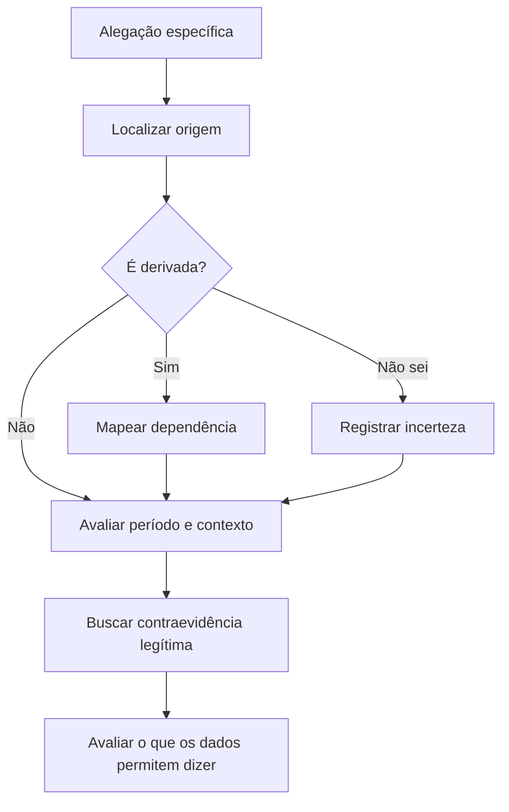

# Avaliação de fontes e qualidade da evidência

[← Início](../README.md) · [Método](metodo.md) · [Matriz de hipóteses](../templates/matriz-de-hipoteses.md)

> **Regra fundamental:** confiabilidade da fonte, qualidade do dado e força da inferência são dimensões diferentes. Uma instituição confiável pode publicar um dado desatualizado; uma notícia precisa pode ser replicada dezenas de vezes sem criar confirmação independente.

## O protocolo VISTA

O **VISTA** é uma proposta didática deste repositório, não um padrão oficial. Serve para revisar cada afirmação de modo consistente.

| Dimensão | Pergunta de controle | Evidência que deve ficar no registro |
|---|---|---|
| **V — Vínculo com a origem** | É a publicação original ou uma reprodução? | Publicador, URL, documento-base, cadeia de citação |
| **I — Independência** | Há apuração própria ou todas as páginas citam a mesma origem? | Mapa de dependências e versões |
| **S — Situação temporal** | A que período o dado se refere? | Data de ocorrência, publicação, edição e consulta, com fuso |
| **T — Transparência** | A metodologia, as correções e as limitações estão documentadas? | Declaração metodológica, versão, notas de atualização |
| **A — Alegação testável** | O material sustenta a conclusão exata proposta? | Trecho relevante, hipótese rival, evidência contrária |

## Classifique cada camada separadamente

| Camada | Exemplo sintético | Como registrar |
|---|---|---|
| **Observação** | A nota E101 contém a data de 18 de agosto. | Texto verificável, URL e data |
| **Origem** | E102 afirma ter copiado a nota E101. | Dependência E102 → E101 |
| **Interpretação** | O evento provavelmente estava agendado para 18/08. | Hipótese, nunca fato consumado |
| **Julgamento** | A data efetiva não está determinada. | Conclusão, alternativas e lacunas |

### Como expressar confiança

Use **sustentada**, **parcialmente sustentada**, **não sustentada** ou **indeterminada**, com justificativa escrita. O método não transforma esses rótulos em probabilidades. Não atribua 85% de confiança sem critérios definidos, dados históricos e calibração.

**Exemplo:** “A afirmação sobre a *data prevista* é sustentada por E101; a alegação de que o evento *ocorreu nessa data* é indeterminada porque não há registro independente da realização.”

## Armadilhas a verificar

1. **Circularidade:** sites A, B e C repetem a mesma postagem.
2. **Falso positivo:** nomes, endereços de sites ou identificadores semelhantes são confundidos.
3. **Viés de seleção:** apenas material que confirma a hipótese é incluído.
4. **Temporalidade:** data de atualização é tratada como data do evento.
5. **Dados ausentes:** falta de resultado é tomada como prova negativa.
6. **Ambiguidade semântica:** “previsto”, “confirmado”, “realizado” e “cancelado” são tratados como sinônimos.

## Fluxo rápido

## Para praticar

- [Lab 02: independência de fontes](../labs/02-triangulacao/README.md)
- [Lab 04: duas notícias e uma premissa](../labs/04-qualidade-de-fontes/README.md)
- [Matriz de hipóteses](../templates/matriz-de-hipoteses.md)

**Referências metodológicas:** [ICD 203 — ODNI](https://www.intel.gov/mission/our-values/objectivity), sobre fontes, incerteza e critérios analíticos; [Berkeley Protocol](https://humanrights.berkeley.edu/publications/berkeley-protocol-on-digital-open-source-investigations/), sobre obtenção e verificação de informações abertas. O VISTA é independente dessas publicações.
