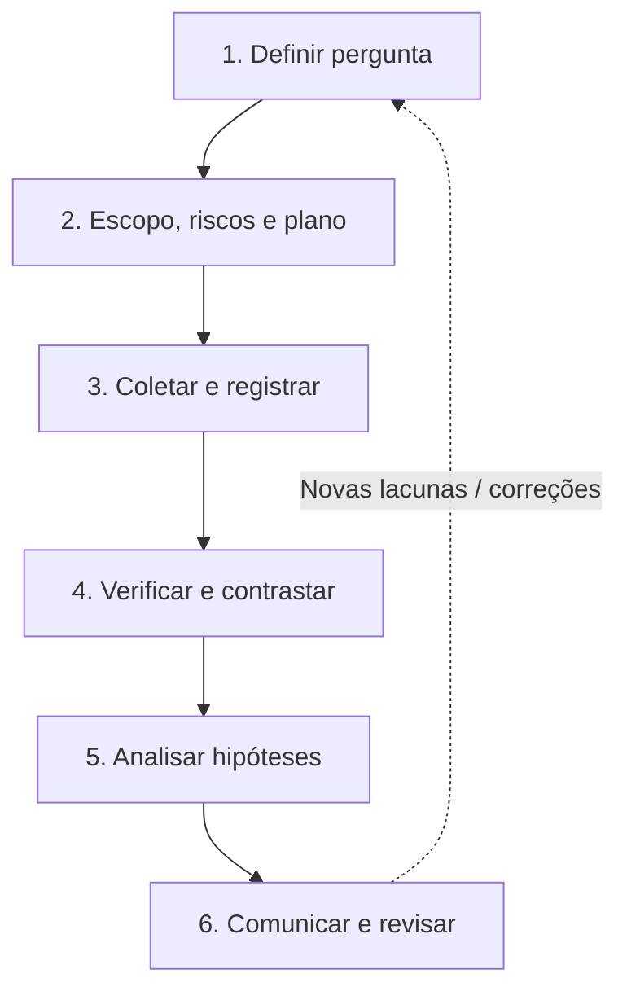

# Método operacional · Da pergunta à conclusão

[← Início](../README.md) · [Mapa de estudos](indice.md) · [Templates](../templates/README.md)

Este guia amplia o método original do repositório: OSINT é um ciclo de investigação baseado em requisitos, fontes justificáveis, verificação, análise e entrega. Não confunda busca com evidência.

## Processo de seis etapas

### 1. Defina a necessidade de informação

Evite a instrução vaga "descobrir tudo sobre X". Use uma pergunta com objeto, período, finalidade e critério de resposta.

**Exemplo sintético:** "Dois comunicados públicos descrevem a mesma data de lançamento do Projeto Aurora?" Uma resposta válida pode ser **sim**, **não** ou **não foi possível determinar**.

Registre: quem usará o resultado, qual decisão será apoiada, o que está fora do escopo e o que mudaria a conclusão.

### 2. Delimite fontes e riscos

Escolha fontes públicas ou autorizadas, recorte temporal, método de registro, restrições jurídicas e uma condição de parada. Considere dados pessoais, direitos autorais, regras das plataformas e eventuais impactos em terceiros. Leia [ética e qualidade](qualidade-e-etica.md).

### 3. Colete com proveniência

Para cada observação relevante, registre:

- **ID** estável, título, autor/publicador e URL ou identificador do documento.
- **Data do evento**, **data de publicação** e **data de consulta** com fuso; elas não são intercambiáveis.
- Trecho/paráfrase objetiva, contexto, tipo de fonte e possíveis transformações.
- Evidência preservada de forma legítima e hash quando necessário. **Hash atesta integridade relativa, não veracidade.**

Prefira preservar apenas o material estritamente necessário. Não reutilize credenciais, bases vazadas nem informação pessoal irrelevante.

### 4. Verifique antes de correlacionar

| Checagem | Pergunta |
|---|---|
| Origem | Quem produziu a informação? A página reproduz outra? |
| Independência | Duas fontes realmente fizeram apurações distintas? |
| Conteúdo | O material foi recortado ou retirado do contexto? |
| Tempo | A data é do fato, da postagem, da edição ou da captura? |
| Espaço | O local é demonstrado por pistas independentes? |
| Contradição | Qual fonte enfraquece a hipótese principal? |

Consulte o [guia de verificação](verificacao.md). A ausência de resultados não comprova inexistência.

### 5. Analise hipóteses alternativas

Separe três camadas:

| Camada | Exemplo |
|---|---|
| **Observação** | E001 e E002 citam a mesma empresa no rodapé. |
| **Inferência** | A empresa pode prestar serviço às duas organizações. |
| **Desconhecido** | Não há evidência sobre propriedade ou vínculo societário. |

Uma fonte copiada por dez publicações ainda pode representar **uma única origem**. Utilize a [matriz de hipóteses](../templates/matriz-de-hipoteses.md), registre evidências contrárias e evite porcentagens arbitrárias de confiança.

Uma classificação qualitativa útil é: **sustentada**, **parcialmente sustentada**, **não sustentada** ou **indeterminada**, sempre acompanhada de justificativa.

### 6. Entregue uma resposta auditável

O relatório deve começar pela pergunta e pela conclusão, citar os IDs das evidências para cada afirmação, declarar incertezas, descrever hipóteses rivais e indicar a data da revisão. Diferencie claramente **fatos observados**, **avaliação analítica** e **recomendação**.

**Pacote mínimo:** [Plano](../templates/plano.md) + [Registro](../templates/evidencias.md) + [Hipóteses](../templates/matriz-de-hipoteses.md) + [Relatório](../templates/relatorio.md).

## Condição de encerramento

Encerre quando a pergunta tiver resposta suficiente para a decisão, quando faltarem fontes legítimas úteis ou quando o custo/risco de continuar não for proporcional. "Não determinado" é resultado analítico válido, não fracasso.

**Referência de princípios:** [Berkeley Protocol, Human Rights Center e OHCHR](https://humanrights.berkeley.edu/publications/berkeley-protocol-on-digital-open-source-investigations/). Este método é uma adaptação pedagógica independente, não uma certificação ou reprodução do protocolo.
