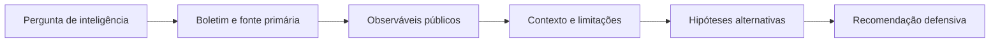

# OSINT para Cyber Threat Intelligence (CTI)

[← Início](../README.md) · [Método](metodo.md) · [Casos de uso](casos-de-uso.md)

Esta trilha trata de **pesquisa defensiva em informações públicas** e da produção de conhecimento útil para SOC, gestão de riscos e defesa. Não envolve testar terceiros sem autorização ou recolher dados sensíveis.

## Do sinal público à decisão defensiva

### Tipos de informações que não são equivalentes

| Elemento | Exemplo sintético | O que não permite concluir |
|---|---|---|
| **Indicador** | Um domínio foi citado em um boletim. | Que todos os acessos a ele foram maliciosos |
| **Comportamento** | O boletim descreve uma técnica de persistência. | Que ela foi observada em sua rede |
| **Relato** | Fornecedor publica análise de um incidente. | Que a atribuição a um grupo está confirmada |
| **Hipótese de ameaça** | Um comportamento seria relevante ao ambiente analisado. | Que a ameaça está ativa naquela organização |
| **Detecção** | Uma regra pode procurar um evento definido. | Que um alerta confirma comprometimento |

## Fluxo de produção

1. **Requisito:** formule uma pergunta ligada a ativos próprios ou autorizados.
2. **Contextualização:** identifique origem, data e público do boletim.
3. **Extração criteriosa:** separe observáveis, técnicas relatadas e inferências de atribuição.
4. **Correlação defensiva:** relacione conceitos à telemetria interna *autorizada* e às lacunas de visibilidade.
5. **Avaliação:** explicite falsos positivos, limitações temporais e dependência de fontes.
6. **Entrega:** apresente ações de revisão, priorização, inventário ou melhoria de monitoramento.

## Mapeamento a referenciais

| Fonte | Papel correto |
|---|---|
| [MITRE ATT&CK](https://attack.mitre.org/) | Vocabulário de comportamentos adversários descritos em relatos, não evidência de ocorrência local |
| [MITRE D3FEND](https://d3fend.mitre.org/) | Ontologia de contramedidas e técnicas defensivas |
| [CISA KEV](https://www.cisa.gov/known-exploited-vulnerabilities-catalog) | Catálogo público de vulnerabilidades conhecidas por exploração; exige contextualizar versões e ativos |
| [NIST SP 800-61 Rev. 3](https://csrc.nist.gov/pubs/sp/800/61/r3/final) | Integração da resposta a incidentes à gestão de risco e às funções do CSF 2.0 |

Nenhuma dessas referências, isoladamente, atribui autoria ou confirma um incidente local.

## Modelo de produção

| Pergunta | Evidência pública | Observação | Avaliação | Próxima ação defensiva |
|---|---|---|---|---|
| O boletim X sustenta a técnica Y? | E01: comunicado original | O documento descreve Y | Sustentada para o **relato** | Verificar cobertura de monitoramento interno |
| Y foi observada localmente? | Nenhuma telemetria fornecida | Não avaliado | Indeterminada | Solicitar revisão autorizada de logs |

## Exercício

Faça o [Lab 05 · Boletim não é atribuição](../labs/05-osint-cti/README.md). O caso é inteiramente fictício e exige distinguir relatos, atribuição e validação defensiva.
